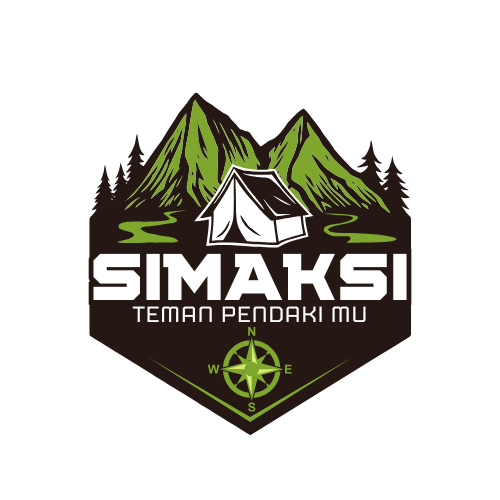
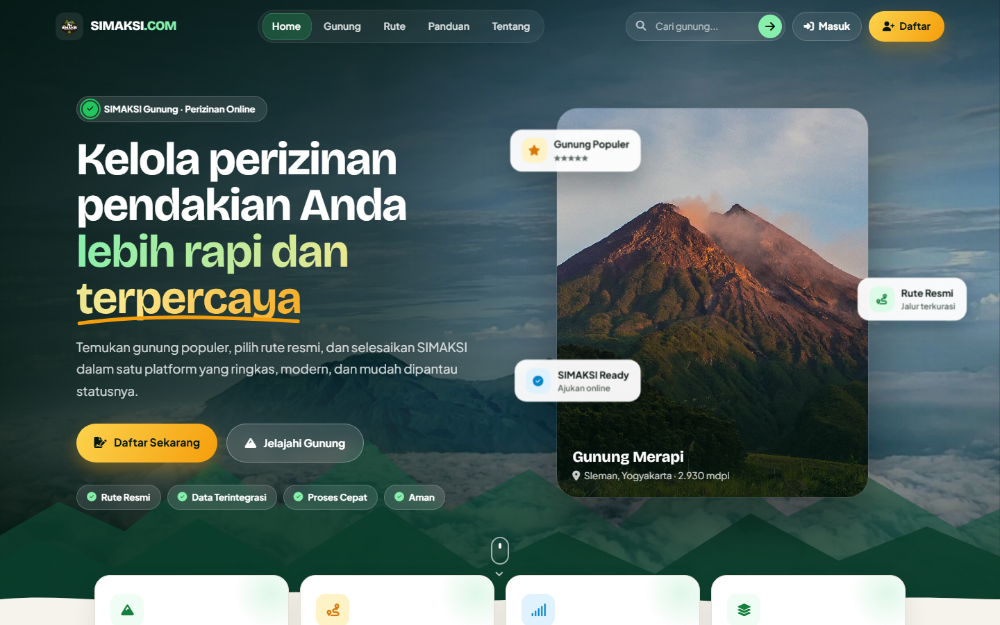
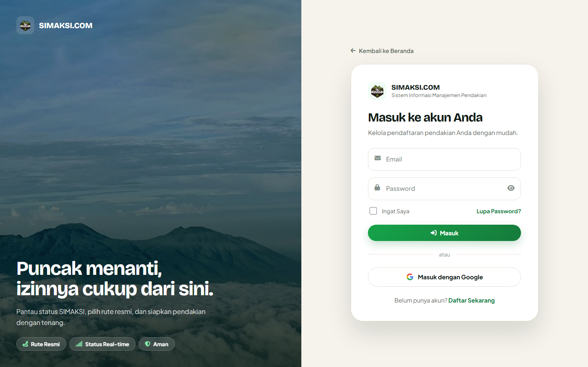
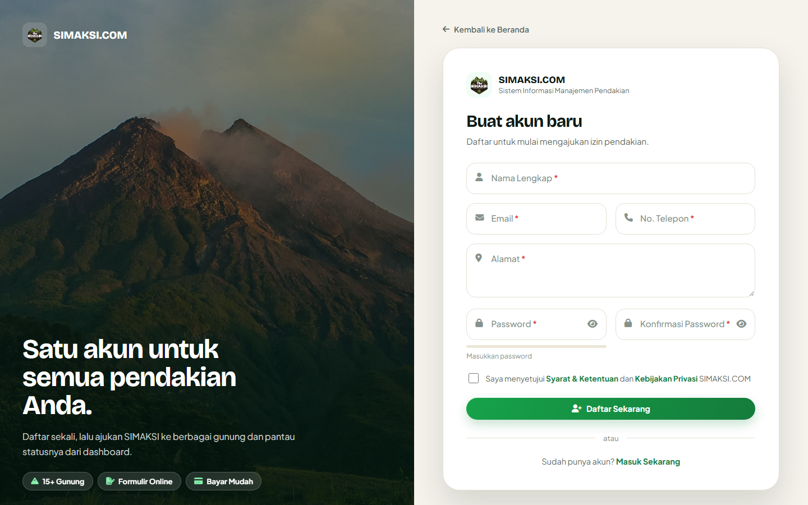
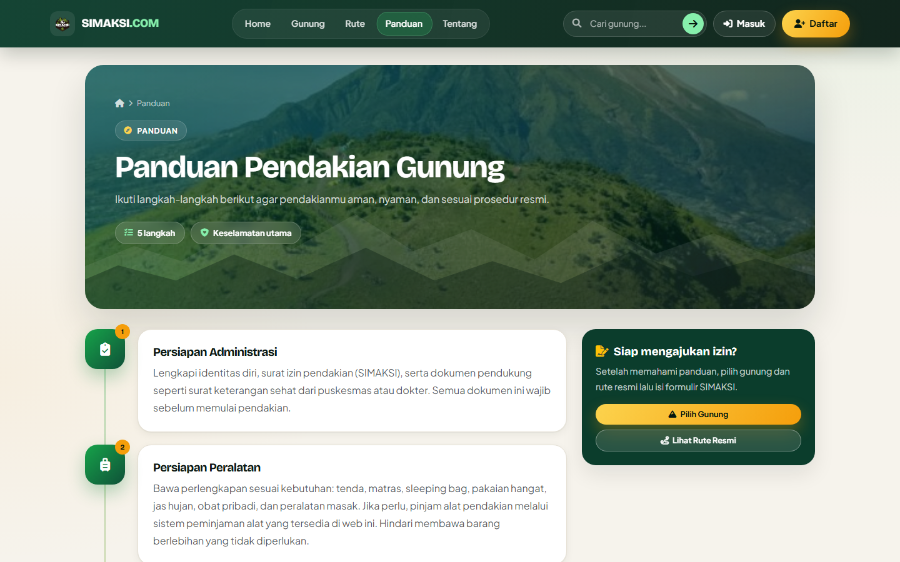
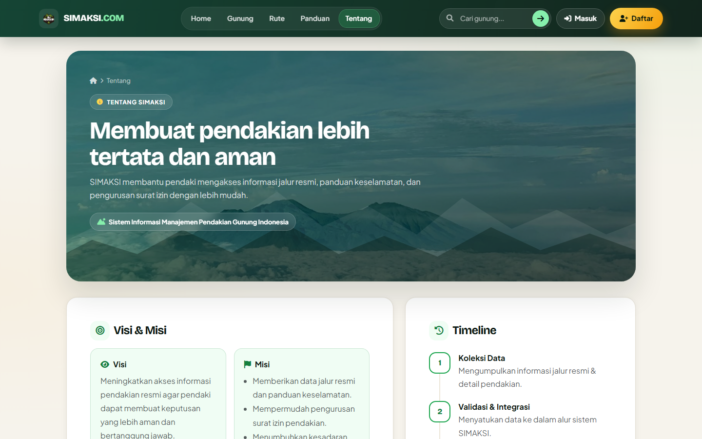
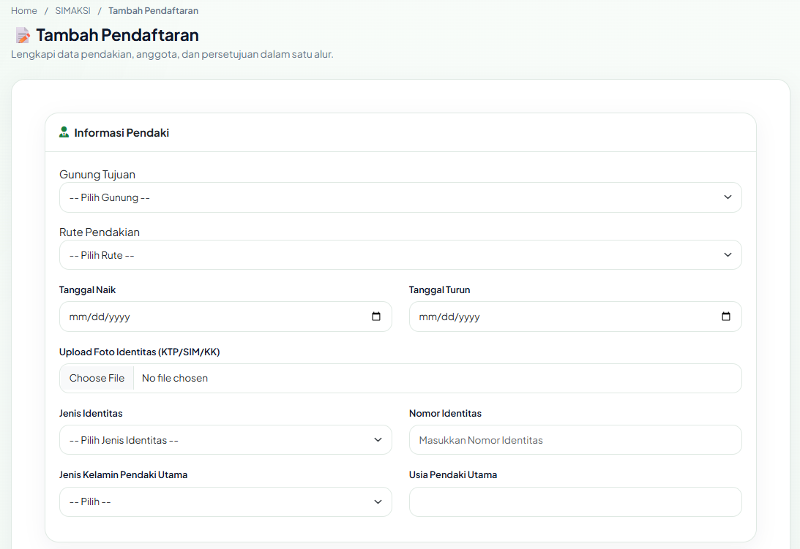
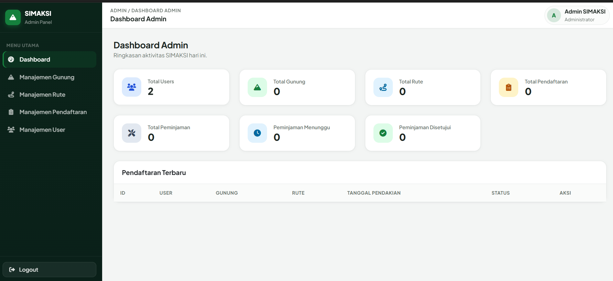
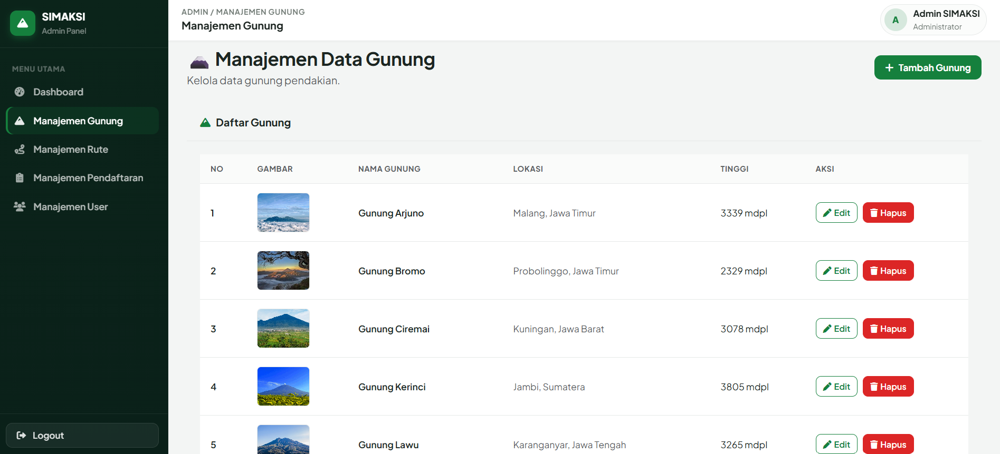

<div align="center">



# SIMAKSI.COM

**Sistem perizinan pendakian gunung (SIMAKSI) berbasis web — pilih gunung, pilih rute resmi, ajukan izin, bayar, dan pantau statusnya dalam satu tempat.**

[](https://laravel.com)
[](https://www.php.net)
[](https://neon.tech)
[](https://getbootstrap.com)
[](https://gsap.com)
[](https://midtrans.com)
[](https://app-eta-ten-11.vercel.app)

### [🌐 Lihat Demo Live](https://app-eta-ten-11.vercel.app)

</div>



## Tentang Proyek

SIMAKSI (Surat Izin Masuk Kawasan Konservasi) adalah izin yang wajib dimiliki pendaki sebelum naik gunung. **SIMAKSI.COM** memindahkan proses itu ke web: pendaki memilih gunung dan jalur resmi, mengisi formulir beserta data anggota rombongan, mengunggah identitas, membayar lewat Midtrans, lalu memantau status persetujuan dari dashboard. Di sisi lain, admin mengelola data gunung, rute, pendaftaran, pembayaran, dan pengguna dari panel tersendiri.

Aplikasi ini sudah berjalan online di **[app-eta-ten-11.vercel.app](https://app-eta-ten-11.vercel.app)** dengan database PostgreSQL di Neon.

## Tampilan

<table>
  <tr>
    <td width="50%"><p align="center"><b>Masuk</b> — email/password atau akun Google</p></td>
    <td width="50%"><p align="center"><b>Daftar Akun</b></p></td>
  </tr>
  <tr>
    <td><p align="center"><b>Panduan Pendakian</b> — 5 langkah persiapan</p></td>
    <td><p align="center"><b>Tentang</b> — visi, misi, dan timeline</p></td>
  </tr>
  <tr>
    <td><p align="center"><b>Formulir SIMAKSI</b></p></td>
    <td><p align="center"><b>Dashboard Admin</b></p></td>
  </tr>
  <tr>
    <td><p align="center"><b>Manajemen Gunung</b></p></td>
    <td></td>
  </tr>
</table>

## Fitur

### Untuk Pendaki

- **Landing page** dengan pencarian gunung langsung dari navbar.
- **Daftar & detail gunung** lengkap dengan lokasi di Google Maps.
- **Rute pendakian resmi** per gunung.
- **Formulir SIMAKSI**: tanggal naik/turun, data pendaki utama, anggota rombongan, dan upload foto identitas (KTP/SIM/KK).
- **Pembayaran online** lewat Midtrans Snap (mode sandbox).
- **Dashboard pribadi**: ringkasan total pendaftaran, menunggu persetujuan, disetujui, dan belum bayar, plus riwayat pendaftaran.
- **Cetak formulir SIMAKSI ke PDF.**
- **Login dengan Google** (aktif bila kredensial Google OAuth diisi).
- Halaman **Panduan** dan **Tentang**.

### Untuk Admin

- **Dashboard** berisi statistik pengguna, gunung, rute, pendaftaran, dan peminjaman alat.
- **CRUD data gunung** (nama, lokasi, ketinggian, gambar, koordinat).
- **CRUD rute pendakian.**
- **Kelola pendaftaran**: lihat detail, ubah data, dan setujui/tolak pengajuan.
- **Pantau pembayaran.**
- **Pantau peminjaman alat** dari sistem peminjaman yang terhubung.
- **Kelola pengguna**: ubah dan hapus akun.

### Alur Pendaftaran

```text
Pilih Gunung → Pilih Rute → Isi Formulir SIMAKSI → Bayar (Midtrans) → Pantau Status → Cetak PDF
```

Status pengajuan: `menunggu` → `disetujui` / `ditolak`. Status pembayaran: `pending` → `lunas`.

## Tech Stack

| Bagian | Teknologi |
| --- | --- |
| Backend | Laravel 12, PHP 8.3 |
| Database | PostgreSQL di [Neon](https://neon.tech) (production) — MySQL juga bisa untuk lokal |
| Tampilan | Blade, Bootstrap 5.3, CSS tema sendiri (`public/css/simaksi-theme.css`) |
| Animasi | GSAP 3.13 + ScrollTrigger (di `public/vendor/gsap/`, menghormati *reduced motion*) |
| Ikon & font | Font Awesome 6, Plus Jakarta Sans, Bricolage Grotesque |
| Notifikasi UI | SweetAlert2 |
| Pembayaran | Midtrans Snap (`midtrans/midtrans-php`) |
| PDF | `barryvdh/laravel-dompdf` |
| Login sosial | Laravel Socialite (Google OAuth) |
| Peta | Google Maps JavaScript API |
| Hosting | Vercel (runtime container, Docker + FrankenPHP) |

Aset tampilan disajikan langsung dari folder `public/`, jadi **tidak perlu build Node/Vite** untuk menjalankan aplikasi.

## Menjalankan di Komputer Sendiri

**Kebutuhan:** PHP 8.2+ (ekstensi `pdo_pgsql` atau `pdo_mysql`, `gd`, `zip`), Composer, dan database PostgreSQL atau MySQL.

```bash
git clone https://github.com/IbnuAugustiana/PENDAKIAN-GUNUNG.git
cd PENDAKIAN-GUNUNG

composer install
cp .env.example .env          # PowerShell: Copy-Item .env.example .env
php artisan key:generate
```

Atur koneksi database di `.env`. Contoh untuk Neon (PostgreSQL):

```env
DB_CONNECTION=pgsql
DB_HOST=ep-xxxxxx.us-east-2.aws.neon.tech
DB_PORT=5432
DB_DATABASE=neondb
DB_USERNAME=neondb_owner
DB_PASSWORD=password-anda
DB_SSLMODE=require
```

Untuk MySQL lokal (misalnya XAMPP), cukup pakai nilai bawaan di `.env.example` (`DB_CONNECTION=mysql`, database `simaksi_gunung`).

Lalu buat tabel, isi data awal, dan jalankan server:

```bash
php artisan migrate --seed
php artisan storage:link
php artisan serve
```

Buka **http://127.0.0.1:8000**.

### Variabel `.env` Lainnya

| Variabel | Kegunaan |
| --- | --- |
| `MIDTRANS_MERCHANT_ID`, `MIDTRANS_CLIENT_KEY`, `MIDTRANS_SERVER_KEY` | Kunci Midtrans (ambil dari dashboard sandbox Midtrans) |
| `MIDTRANS_IS_PRODUCTION` | `false` untuk sandbox |
| `GOOGLE_MAPS_KEY` | Peta lokasi gunung |
| `GOOGLE_CLIENT_ID`, `GOOGLE_CLIENT_SECRET`, `GOOGLE_REDIRECT_URI` | Login dengan Google |
| `PEMINJAMAN_API_URL`, `SIMAKSI_WEBHOOK_URL`, `SIMAKSI_API_TOKEN`, `INTEGRATION_TOKEN`, `WEBHOOK_SECRET` | Integrasi dengan sistem peminjaman alat (opsional) |

Jangan pernah meng-commit file `.env` yang berisi kunci asli.

## Akun Bawaan Seeder

Setelah `php artisan migrate --seed`, akun berikut tersedia untuk uji coba di lokal:

| Peran | Email | Password |
| --- | --- | --- |
| Admin | `admin@gmail.com` | `admin123` |

Akun tambahan bisa dibuat dengan `php artisan db:seed --class=AdminSeeder` (admin `admin@simaksi.com` / `admin123` dan pendaki `user@simaksi.com` / `user123`). Pendaki juga bisa mendaftar sendiri lewat halaman **Daftar**.

> Ganti password akun-akun ini di server production — kredensialnya tercantum di kode seeder yang publik.

## Deploy ke Vercel + Neon

Proyek ini di-deploy memakai **runtime container Vercel**: `vercel.json` mengarahkan semua request ke `Dockerfile`, yang membangun image PHP 8.3 + FrankenPHP dengan ekstensi `pdo_pgsql`.

1. Buat database di [Neon](https://neon.tech), lalu jalankan `php artisan migrate --seed` dari komputer lokal dengan `.env` yang mengarah ke Neon.
2. Import repository ini di Vercel.
3. Isi **Settings → Environment Variables** di Vercel: `APP_KEY`, `APP_URL`, `DB_HOST`, `DB_DATABASE`, `DB_USERNAME`, `DB_PASSWORD`, kunci Midtrans, dan kunci Google bila dipakai. Nilai non-rahasia (`APP_ENV=production`, `DB_CONNECTION=pgsql`, `DB_SSLMODE=require`, sesi & cache di database) sudah diatur di `Dockerfile`.
4. Setiap `git push` ke branch `main` otomatis memicu deploy baru.

**Catatan:** file system Vercel tidak permanen, jadi foto identitas yang diunggah bisa hilang saat redeploy. Untuk pemakaian sungguhan, simpan upload di object storage (misalnya S3 atau Cloudflare R2).

## Struktur Folder Penting

```text
app/Http/Controllers/     Logika halaman pendaki, admin, pembayaran, dan API
resources/views/          Template Blade (landing, auth, pendaftaran, admin, pdf)
public/css/               Tema tampilan SIMAKSI
public/js/                Animasi halaman (GSAP)
database/migrations/      Struktur tabel
database/seeders/         Data awal: 13 gunung populer Indonesia, rute, dan akun admin
docs/images/              Screenshot untuk README
Dockerfile, Caddyfile     Konfigurasi container untuk Vercel
```

## Pembuat

**Ibnu Augustiana** — [github.com/IbnuAugustiana](https://github.com/IbnuAugustiana)

Proyek portofolio. Kode sumber: [IbnuAugustiana/PENDAKIAN-GUNUNG](https://github.com/IbnuAugustiana/PENDAKIAN-GUNUNG).

### Kredit

Dikembangkan dari proyek awal *SIMAKSI Gunung* karya Muhamad Naufal Nazih.
